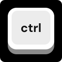
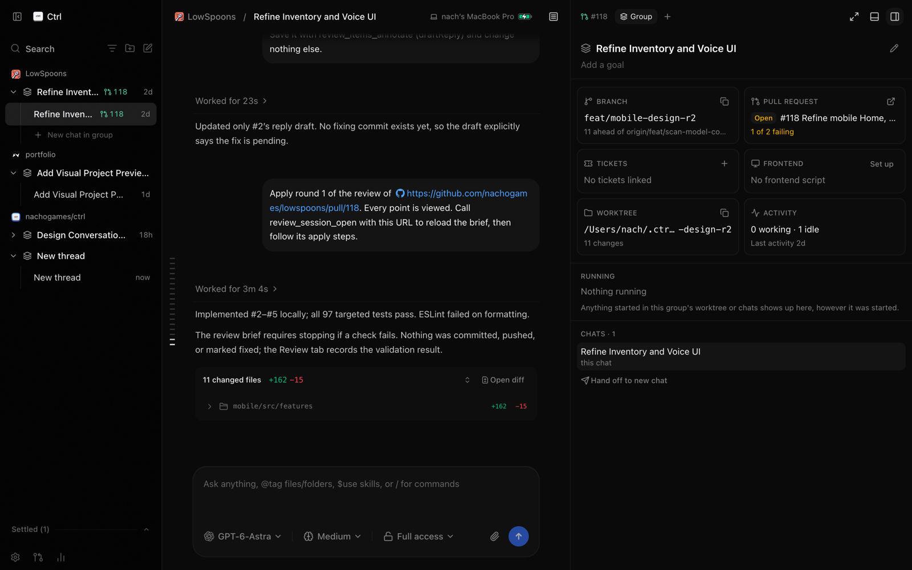
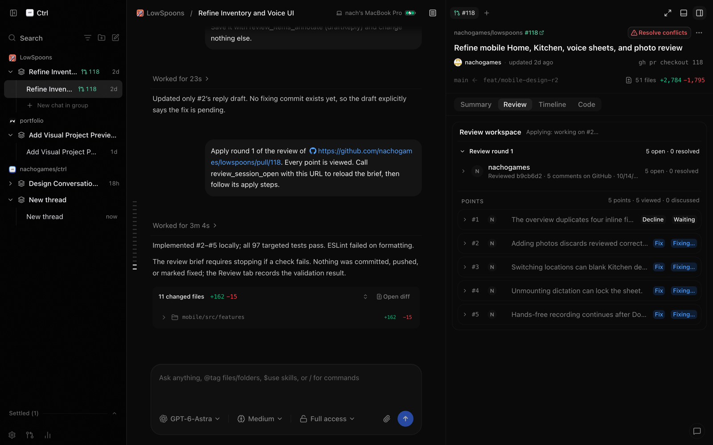
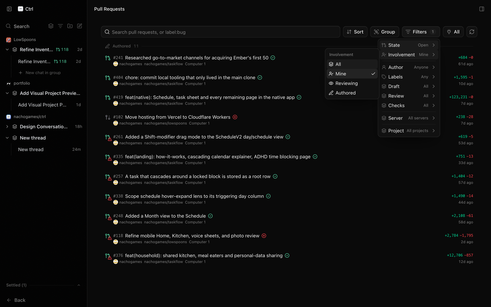
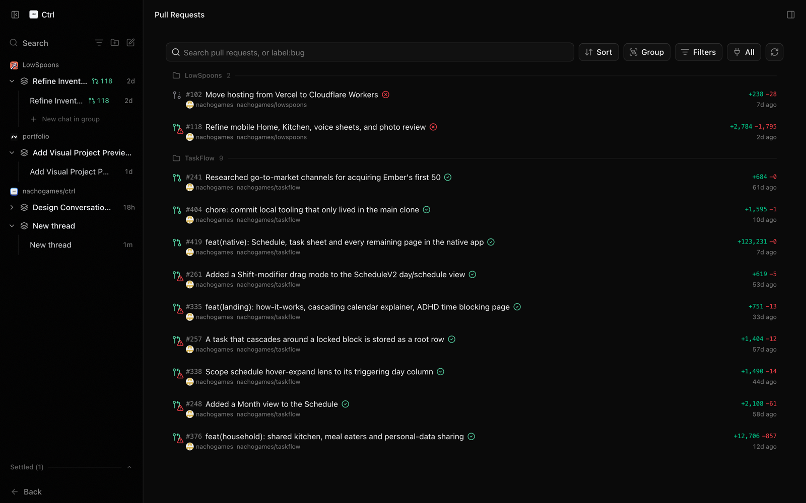
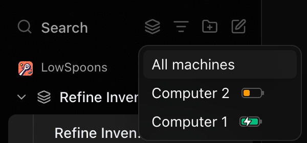
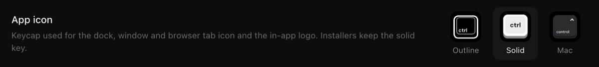

<p align="center"></p>

# Ctrl

Ctrl is a control surface for the coding agents on your machine (Claude Code, Codex, Cursor, Grok Build, OpenCode and Google Antigravity), with web, desktop and mobile clients.

> [!NOTE]
> **Ctrl is a personal fork of [T3 Code](https://github.com/pingdotgg/t3code).** Nearly everything here is the T3 team's work: Theo, Julius and every T3 Code contributor built the app, the server and the clients this fork stands on. Thank you. Ctrl adds a few features of its own (listed below) and tracks upstream closely. If you want the real thing, with releases, support and the mobile apps in the stores, use [T3 Code](https://t3.codes). Bugs that also happen in T3 Code belong [upstream](https://github.com/pingdotgg/t3code/issues). T3 Code's MIT license and copyright notice are kept unchanged in [LICENSE](LICENSE).

Ctrl installs alongside T3 Code: it keeps its data in `~/.ctrl` (override with `T3CODE_HOME`) and uses its own app ids, so the two never share state. Ctrl shares the `t3code://` URL schemes with an installed T3 Code, so sign-in and deep links open whichever app registered last.

## What Ctrl adds

### Chat groups

Related chats, their branch, worktree, pull request and running processes live together in a group. The group panel shows it all in one place, and **Hand off to new chat** continues the work in a fresh chat without losing context.



### PR review workspace

The Review tab collects every review of a pull request, from GitHub and from your agents, into numbered rounds of points. Decide each point (fix, decline, discuss), then **Apply** the round and the agent makes the fixes and drafts the replies.



### Your pull requests, and only yours

The Pull Requests page has a **Mine** filter (under **Filters → Involvement**) that shows only pull requests you wrote or were asked to review, so other people's PRs in repos you merely cloned stay out of the way.



**Group → Project** sorts the list into one section per project.



### Every machine, at a glance

Connect several computers and the sidebar can show one machine's chats at a time. Each machine reports its battery level and whether it's charging, so you can see which laptop is about to die before you start work on it.



### And smaller things

- Three keycap app icons (Outline, Solid, Mac) under **Settings → Appearance**.

  

- Phone alerts sent directly from your server through Ctrl's push relay, with no T3 Connect.
- Signed desktop builds that update themselves, and Android updates over the air.

## Installation

> [!IMPORTANT]
> The install commands, package-manager entries and store links below come from upstream and install **official T3 Code**, not Ctrl. Ctrl has no published releases; build it from source (see the contributing section at the end).

> [!WARNING]
> T3 Code currently supports Codex, Claude, Cursor, Grok Build, OpenCode, and Antigravity. Install and authenticate at least one provider before use:
>
> - Codex: install [Codex CLI](https://developers.openai.com/codex/cli) and run `codex login`
> - Claude: install [Claude Code](https://claude.com/product/claude-code) and run `claude auth login`
> - Cursor: install [Cursor CLI](https://cursor.com/cli) and run `agent login`
> - Grok Build: install [Grok Build CLI](https://x.ai/cli) and run `grok login`
> - OpenCode: install [OpenCode](https://opencode.ai) and run `opencode auth login`
> - Antigravity: enable it in Settings, then use **Install Antigravity** and **Sign in with Google**. No CLI is required.

### Command line

```bash
curl -fsSL https://t3.codes/install.sh | sh
```

On Windows, in PowerShell:

```powershell
irm https://t3.codes/install.ps1 | iex
```

Then run `t3` to start the server and open the local web app. `t3 service install` keeps it running in the background, `t3 update` moves to a newer release, and `t3 --help` has the full reference.

To try it once without installing, run `npx t3@latest` instead.

### Desktop app

These install official T3 Code. Install the latest version of the desktop app from [GitHub Releases](https://github.com/pingdotgg/t3code/releases), or from your favorite package registry:

#### Windows (`winget`)

```bash
winget install T3Tools.T3Code
```

#### Windows (`scoop`)

```bash
scoop install extras/t3code
```

#### macOS (Homebrew)

```bash
brew install --cask t3-code
```

#### Debian, Ubuntu (`.deb`)

Download the `.deb` from [GitHub Releases](https://github.com/pingdotgg/t3code/releases), then:

```bash
sudo apt install ./T3-Code-*.deb
```

#### Arch Linux (AUR)

Stable:

```bash
yay -S t3code-bin
```

Nightly:

```bash
yay -S t3code-nightly-bin
```

The AUR packaging is maintained in this repository under [`packaging/aur`](./packaging/aur).

## Some notes

We are very very early in this project. Expect bugs.

We are (mostly) not accepting contributions yet. Small fixes may be considered. Big features will not be.

## Documentation

Full docs live in [docs/](./docs). There's no docs site yet.

- [Install and first run](./docs/user/install.md)
- [Permission modes](./docs/user/permission-modes.md)
- [Keyboard shortcuts](./docs/user/keybindings.md)
- [Project settings](./docs/user/project-settings.md)
- [Appearance preferences](./docs/user/appearance.md)
- [Remote access from a phone or another machine](./docs/user/remote-access.md)
- [Connect Claude Code, Codex, ChatGPT and other agents over MCP](./docs/user/outside-agents.md)
- [Keeping app and server in sync](./docs/user/updating.md)
- [Source control integrations](./docs/user/source-control.md)
- Multiple accounts: [Codex](./docs/user/providers-codex.md) · [Claude](./docs/user/providers-claude.md)
- [Run T3 Code as a background service](./docs/user/background-service.md)

Building from source? Start at [docs/internals/overview.md](./docs/internals/overview.md).

## If you REALLY want to contribute still.... read this first

### Install `vp`

T3 Code uses Vite+ so you'll need to install the global `vp` command-line tool.

#### macOS / Linux

```bash
curl -fsSL https://vite.plus | bash
```

#### Windows

```bash
irm https://vite.plus/ps1 | iex
```

Checkout their getting started guide for more information: https://viteplus.dev/guide/

### Install dependencies

```bash
vp i
```

Read [CONTRIBUTING.md](./CONTRIBUTING.md) before reporting a bug or opening a PR.

Have a feature request? Start an [Ideas discussion](https://github.com/pingdotgg/t3code/discussions/categories/ideas).

Need support? Join the [Discord](https://discord.gg/jn4EGJjrvv).
