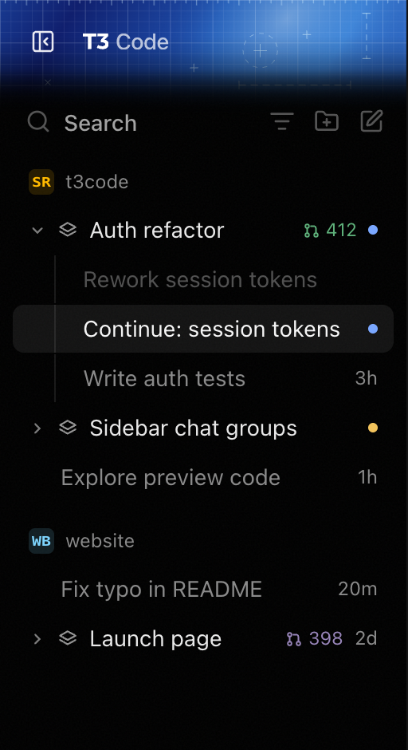
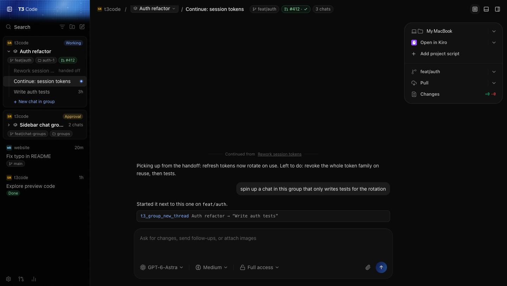
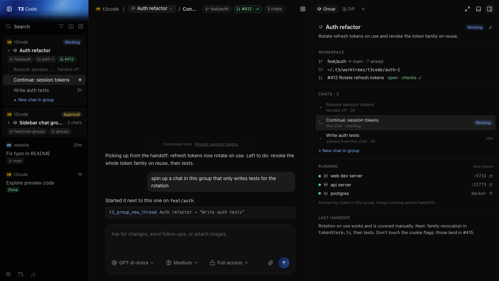

# Chat groups

Date: 2026-10-10
Status: approved design, awaiting spec review

## Problem

A chat picks up a working context as it goes: a branch, a worktree, a PR, dev servers on
certain ports, Docker containers. When the chat gets long you hand off to a fresh one, and
now two or more chats share that context with nothing tying them together. The sidebar shows
them as unrelated rows, the new chat doesn't know what's running, and finding "everything for
this PR" means scanning titles.

## Goals

- Group the chats that belong to one unit of work (usually one branch/PR) and show them
  together under their project.
- Start a new chat inside a group, already on the group's branch and worktree.
- Hand off from a long chat to a fresh chat in the same group, with a written summary.
- Show a group's workspace, chats, running servers/containers, and last handoff in one panel.
- Let the AI manage groups through tools, not only the user through UI.

## Non-goals

- Inferring groups automatically from matching branches. Groups are explicit.
- Groups spanning more than one project.
- Mobile app (`apps/mobile`) support. Web and desktop only.
- Upstreaming. This is for a personal fork; upstream requires prior maintainer approval for
  features (see CONTRIBUTING.md).

## Design

### Concepts

A **group** belongs to exactly one project and owns one workspace: a branch, a worktree path,
and optionally a pull request. Every chat in a group works in that workspace. A chat is in at
most one group. Chats not in a group behave exactly as today.

A group has: id, projectId, title, goal (one or two sentences, optional), branch,
worktreePath, pullRequest (reuses `ThreadPullRequestLink`, optional), lastHandoff (summary
text, source chat, target chat, time; optional), pinned/snoozed/settled state, createdAt,
updatedAt.

A chat records `groupId` (nullable) and, when it was created by a handoff, `handedOffFrom`
(source thread id). A chat that has been handed off is marked `handedOffTo` and shown dimmed.

### How groups form

Groups are only created on purpose:

| Action                                                                                                                                          | Result                                                                                                                                                                                                 |
| ----------------------------------------------------------------------------------------------------------------------------------------------- | ------------------------------------------------------------------------------------------------------------------------------------------------------------------------------------------------------ |
| Hand off a chat (UI or AI)                                                                                                                      | If the chat has no group, create one from its branch/worktree/PR and put both chats in it. Otherwise the new chat joins the existing group.                                                            |
| Fork a chat                                                                                                                                     | Joins the source's group if it has one; never creates a group (decided 2026-10-10). Handoff links are not copied.                                                                                      |
| "New chat in group" (sidebar row, group menu, panel, new `chat.newInGroup` keybinding command, unbound by default since ⌘⇧N is `chat.newLocal`) | New draft chat with the group's branch, worktree, env mode `worktree`. Joins the group on first send.                                                                                                  |
| Drag a chat onto another chat or group row                                                                                                      | Join that group (creating one if the target is a lone chat). Allowed only when both are in the same project; if workspaces differ, the moved chat switches to the group's worktree after confirmation. |
| "Move to group…" / "Remove from group" (chat menu)                                                                                              | Move or detach. Detaching keeps the chat's current branch/worktree.                                                                                                                                    |
| "Ungroup" (group menu)                                                                                                                          | Deletes the group; chats keep their workspace and become ungrouped.                                                                                                                                    |

The title defaults to the PR title if there is a PR, else the branch name humanized
(`feat/auth-refactor` → "Auth refactor"). Rename anytime.

A group **settles** when every chat in it is settled or its PR merges. Settled groups move to
the existing Settled section collapsed. Pin and snooze apply to the whole group.

### Sidebar (option A: project › group › chat)

- Within the Active section, rows are organised as a tree: project heading (badge + name), then
  that project's groups and ungrouped chats, sorted by most recent activity.
- All rows are single-line. A group row shows: chevron, stack icon, title, then on the right the
  PR number (when there is one, coloured by state: open green, merged purple, closed/draft
  grey), then either a status dot (working / needs approval / input / failed, same colours as
  today's status pills) or the relative time.
- Chats in a group are indented under a thin guide line. A handed-off chat is dimmed. The chat
  count shows on hover of a collapsed group, not inline.
- The group containing the open chat auto-expands; others remember their own expanded state
  (per group, persisted like project expansion is today).
- "+ New chat in group" is the last child of an expanded group: a muted row that brightens on hover or focus (a hover-only row read as a blank gap and shifted the list).
- Pinned and Settled sections keep working: a pinned group shows as a group row in Pinned; a
  settled group appears collapsed in Settled. Snoozed works the same way.
- The existing project-scope filter still applies.
- No branch/worktree chips in the sidebar. Those live in the header and the Group panel.

### Chat header

For a chat in a group the breadcrumb is `project / [Group ▾] / chat title`.

- The group segment is a dropdown: the group's chats (to switch), "New chat in group",
  "Open group panel".
- After the breadcrumb, chips for branch, PR with check status, and chat count. Clicking a chip
  opens the Group panel at that section.
- The chips hide when the Group panel is open (the header is too narrow then and the panel shows
  the same thing) and when the header lacks room; the breadcrumb title must never truncate
  before the chips do.

### Group panel

A new right-panel surface, **Group** (shortcut `G`), alongside Browser, Terminal, Files, Diff,
Pull request, Device. Available only for chats in a group. Sections, top to bottom:

1. **Header**: stack icon, title (editable inline), aggregate status pill, goal (editable).
2. **Workspace**: branch with ahead/behind vs base; worktree path (click to open in the
   configured editor); PR number, title, state, and checks (click opens the existing Pull
   request surface).
3. **Chats**: every chat in the group with a one-line subtitle (handed off / this chat /
   started from X / idle Nh) and status. Ordered by handoff chain, then creation time.
   "+ New chat in group" at the bottom.
4. **Running**: servers and containers attributed to the group (see below), each with a status
   dot, name, port or "docker", and an open-in-browser/preview action. A footnote explains
   they persist across handoffs.
5. **Last handoff**: the most recent handoff summary, with a link to the source chat.

### Handoff

New action "Hand off to new chat" (chat menu, command palette, and AI tool). The current chat's
agent writes a summary (state, next steps, things not to touch). T3 then:

1. Creates the group if needed (see table above).
2. Launches a new chat in the group on the group's workspace (`existing_worktree` launch
   strategy) with the summary as hidden context and a visible "Continued from …" divider.
3. Marks the source chat `handedOffTo` and settles it if the user has auto-settle enabled.
4. Stores the summary as the group's `lastHandoff`.

When triggered from the UI, T3 sends the current chat a fixed prompt asking it to call
`t3_group_handoff` with its summary, so the summary always comes from the agent that has the
context.

### AI tools

New MCP tools next to the existing `t3_thread_*` tools, same scoping rules (default to the
calling thread's project/group):

| Tool                   | Purpose                                                                                            |
| ---------------------- | -------------------------------------------------------------------------------------------------- |
| `t3_group_read`        | Read a group (default: the caller's), including chats, workspace, running resources, last handoff. |
| `t3_group_create`      | Create a group from given chats (default: the caller) with optional title/goal.                    |
| `t3_group_update`      | Rename, set goal, pin/unpin, settle/unsettle.                                                      |
| `t3_group_new_thread`  | Start a chat in a group with an initial prompt.                                                    |
| `t3_group_handoff`     | Hand off the caller to a new chat in its group with a summary.                                     |
| `t3_group_move_thread` | Move a chat into a group or remove it from its group.                                              |
| `t3_group_resource`    | Register or remove a running resource the scanner can't see (e.g. a remote service).               |

Tool results name the group they touched, so the chat transcript shows it.

### Running resources

- **Servers.** `apps/server/src/preview/PortScanner.ts` already reports listening local servers
  with pid and, when started from a T3 terminal, the owning `threadId`. A server belongs to a
  group if its terminal's thread is in the group, or if the process's working directory is
  inside the group's worktree (resolved via `lsof -p <pid> -d cwd` on macOS/Linux). The group
  panel retains the scanner while open; the sidebar does not poll.
- **Docker.** New `DockerScanner` that runs `docker ps --format '{{json .}}'` when Docker is
  available and matches containers to a group by the
  `com.docker.compose.project.working_dir` label being inside the group's worktree. Missing or
  unreachable Docker is not an error; the section just omits containers.
- **Manual.** Resources registered with `t3_group_resource` are stored on the group and shown
  with a "registered" marker; they are not health-checked.
- Running resources are computed live and not persisted, except manual ones.

## Data and plumbing

The orchestration-v2 event log is thread-scoped (every event carries a `threadId` and every
command routes to one thread), so a group is **not** a v2 thread aggregate. It is a new
application aggregate kind, `thread-group`, built the same way projects are
(`ApplicationProjectEvent` in `packages/contracts/src/applicationEvent.ts`, applied by
`ProjectStoreV2`). Membership lives on the thread and travels like `activeOrderKey` does
(`Orchestrator.ts`, `ProjectionStore.ts`, `models.ts`).

- **Contracts**: `ThreadGroupId`; `thread-group.created|meta-updated|deleted` application
  events (meta-updated payload is partial: absent = unchanged, null = clear); optional
  `groupId`, `handedOffFrom`, `handedOffTo` on `OrchestrationV2AppThread`,
  `OrchestrationV2ThreadShell` and their JSON variants; the same fields on
  `thread.metadata.update`; optional `groupId` on `thread.create` and
  `OrchestrationV2ThreadLaunchInput`.
- **Storage**: a new migration adds `projection_thread_groups`, mirroring
  `projection_projects`. Thread fields ride in the existing thread `payload_json`; no thread
  table migration.
- **Server**: `ThreadGroupStore` (apply/get/list/shells, like `ProjectStoreV2`) and a group
  service that creates, updates and deletes groups and moves threads (by dispatching
  `thread.metadata.update`). Group shells reach clients the way project shells do.
- **Derived state**: a group's aggregate status (most urgent child status) and auto-settle are
  computed from its member threads on the client and in the group service, not stored.
- **Client** (`packages/client-runtime`): `presentThreadGroup`, group shells in state, group
  command helpers.
- **Web**: sidebar tree in `Sidebar.tsx` / `Sidebar.logic.ts`; header in the chat header
  component; new `GroupSurface` registered with the right-panel surfaces; handoff action.
- **MCP**: new `apps/server/src/mcp/toolkits/group/` toolkit.

## Error handling

- Moving a chat into a group with a different worktree requires confirmation; if the switch
  fails (dirty tree, missing path) the chat stays where it was and the error is shown.
- If a group's worktree is deleted outside T3, the panel shows the workspace as missing with a
  "Recreate worktree" action; chats remain readable.
- Handoff failures (agent didn't produce a summary, launch failed) leave the source chat
  untouched and report the failure in the source chat.
- Scanner failures (no lsof, Docker down) degrade to an empty or partial Running section, never
  an error banner.
- Deleting the last chat in a group deletes the group.

## Testing

- Orchestrator decider and projection: create/update/delete groups, move/detach, handoff,
  settle rules, status aggregation (unit tests beside `Orchestrator.ts` and `ProjectionStore.ts`).
- Sidebar logic: tree building, sorting, auto-expand, pinned/settled/snoozed placement
  (extend `Sidebar.logic.test.ts`).
- MCP tools: scoping and results (follow `mcp/toolkits/core.test.ts`).
- Resource attribution: terminal-thread and cwd matching, Docker label matching, missing Docker.
- Browser test of the sidebar, header and Group panel against the dev server.

## Build order

1. Data model, commands, events, projection, migration.
2. Sidebar tree and group row.
3. Chat header and Group panel (without Running).
4. Handoff and the MCP tools.
5. Running: server attribution, then Docker, then manual resources.

## Follow-ups recorded after Plan 1 (data foundation)

Plan 1 shipped the data layer. Its reviews left these requirements for later plans:

- **Plan 2 (sidebar/header/panel):** a thread whose `groupId` points at a deleted or unknown group
  renders as ungrouped; subagents never appear in group member lists; `create`/`moveThread` should
  reject subagent thread ids (today they succeed with no visible effect); surface specific errors
  from `threadGroups.mutate` instead of the generic "Failed to change the thread group.";
  check whether moving a chat bumping its `updatedAt` affects sidebar sort order.
- **Plan 4 (handoff/new chat in group/AI tools):** launch-into-group, new-chat-in-group and handoff
  must go through a ThreadGroupService helper that holds the group lock (today `launchThread` with a
  `groupId` checks the group without the lock, so a concurrent delete/prune can leave a thread
  pointing at a deleted group); the reuse-existing-thread path must prune the thread's old group;
  move the launch group check after the receipt short-circuit so retries stay idempotent; decide and
  test the fork rule (forks currently keep the source's `groupId` and clear handoff links).
- **Later migration:** the original `idx_orchestration_events_application_high_water` index is kept
  only so older builds can open the same database; drop it once that no longer matters.

## Backlog

- **Move chat to project.** T3 Code fixes a thread's project once it has messages (only drafts can
  move). Add "Move to project…" for existing chats (including no-project chats in `~/.t3/scratch`),
  alongside "Move to group…", with the workspace consequences made explicit (a no-project chat has
  no git workspace; moving it into a project points it at that project's checkout or a new worktree).
